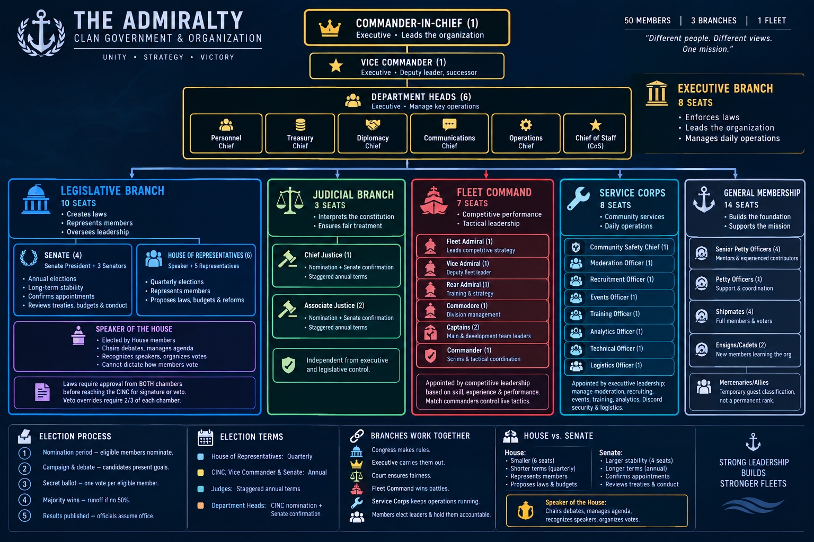

# The Admiralty Chronicle: The First YOLO Season

**Version:** v0.1 proposal / fictional mock season  
**Genre:** Tournament chronicle, participant instruction, tactical case study and governance drama  
**Status:** All characters and dialogue are fictional dramatizations based on the supplied Admiralty handbook. Match events, sample scores and bracket pairings are invented for teaching. The source rules and proposals are explicitly separated.

<figure>

<figcaption>The Admiralty's command architecture is the visual spine of this chronicle. It is not a real YOLO staffing roster or participant cap.</figcaption>
</figure>

## Prologue — The Chartroom and the question of command

The Admiralty handbook begins with a clan that wants to govern itself without becoming a collection of competing voices. Its fifty positions are divided into six groups: Executive, Legislative, Judicial, Fleet Command, Service Corps and General Membership. The chart looks ceremonial, but its deeper purpose is practical: no single office should write the rules, call the battle, count the score and judge the appeal.

The first YOLO season will test that principle.

Rowan “Anchor” Pierce, Commander-in-Chief, stands in the Chartroom with the organizational chart spread across the table. Elias “Wake” Mercer, his former co-captain, is already marking the margins.

“Who decides when the room is wrong?” Elias asks.

“The referee,” Rowan replies.

“Who decides whether the score is wrong?”

“The scorekeeper checks the evidence.”

“And if the scorekeeper is wrong?”

“An independent reviewer.”

Elias taps the chart. “Then you need to keep those jobs separate.”

Ava “Chartroom” Keene, Senate President, closes the ledger. “And you need to publish the rule before anyone is asked to obey it.”

Mira “Valkyrie” Solano, the Vice Commander, looks toward the training calendar. “We also need a path for the new players. If they only see a bracket, they'll think the tournament is a wall.”

Jonah “Tide” Bell has already drawn a rotation of mentors and callers. “Then we'll make the first night a rehearsal. No one should have to learn a room rule during a live match.”

The decision becomes the first charter of the mock season:

- The Executive coordinates and publishes.
- The Legislative body proposes and reviews durable rules.
- The Judiciary independently hears appeals.
- Fleet Command teaches and calls tactics.
- The Service Corps runs the event, evidence and support systems.
- General Membership competes, mentors and keeps the community alive.

This is the Admiralty's fictional structure translated into tournament work. The fifty positions in the handbook do not become fifty tournament jobs. The story borrows its separation of responsibilities and its visual identity, not its headcount.

## Chapter I — Pilot Night: the first room

### The muster

The Pilot source describes a drop-in rehearsal: no prior registration, an entry cutoff one hour before the start, final lineups thirty minutes before play, visible lineups, and Training Rooms. A room is planned around six humans and six bots; when fewer humans attend, the bot count mirrors the human count. The Pilot source describes approximately seven games per participant.

The Events Officer, Rafael “Quarterdeck” Ortiz, posts the notice. Mira asks for a beginner-friendly voice route. Jonah confirms the mentors. Victor “Spear” Moreno, Fleet Admiral, appoints a caller and a backup. Ava assigns a scorekeeper. Darius “Keel” Holt asks that the evidence folder not expose private Discord messages or player account details.

Ava posts the checklist:

**PILOT NOTICE — MOCK EXAMPLE**
- Entry closes: one hour before the event.
- Final lineups: thirty minutes before games.
- Room: Training Room.
- Baseline battle: Standard Battle, ten minutes.
- Evidence: original post-battle screenshot showing damage and Win/Loss.
- Referee: contact the event help desk before ready-up if the room is incorrect.

The Pilot source also describes an Ocean special-mode final match. The documents disagree on its label and duration: one Pilot entry says five minutes, another source table says ten, and the recurring Race narrative describes thirty minutes. The mock Pilot does not invent a resolution. The event uses the verified ten-minute Standard Battle baseline and holds the special-mode final until the current-client mode and duration are approved.

### The room

The Home Team host opens the room and names it `Team 1 vs Team 2`. Both representatives check the map, mode, timer, side, lineup and observer slots. The room is correct. The teams ready up.

Victor gives the first tactical instruction:

“Do not chase the first red icon. Find the approach. Share the spot. Let the guns arrive together.”

The destroyer player takes a scouting line. The cruiser holds a support angle. The battleship anchors the center lane without exposing a broadside. The bot ships move into view. A bot turns toward the closest threat; the human team uses that movement to build a crossfire.

The CBStrat guide is about Tier X Clan Battles, not YOLO's mixed low-tier bot/human format. Victor does not copy its seven-ship lineup or assume every ship has radar. He adapts the principles: vision, objective control, target priority, focus fire, crossfire, push/hold decisions and disengagement.

### The first evidence dispute

After the match, one screenshot shows a damage value that looks like 64,708. Another reader suggests 64,768. The scorekeeper refuses to settle the disagreement by confidence score.

“Original image first,” Ava says. “Candidate text second. Accepted record last.”

DWBOT requires nine mandatory fields in this exact order:

1. `result`
2. `player`
3. `map`
4. `mode`
5. `battleStart`
6. `credits`
7. `freeXp`
8. `damage`
9. `xp`

The scorekeeper checks the original post-battle screenshot and the replay. If a field cannot be supported, it remains unresolved. No one redraws a digit, edits the screenshot or fills a blank from another player's record.

The Pilot ends with a lesson: a tournament needs more than a bracket. It needs a trustworthy record.

## Chapter II — Week One: the random draft

### A new crew

The recurring YOLO source changes the structure. Players register for the weekly event; a new random draft forms the teams. Lineups are hidden until the approved reveal point. Round 1 seeding is first-come-first-served; later rounds use wins. The source describes three rounds, about seven games per player, and mixed bot/human contests after the opening bot round.

Mira and Jonah build a mentoring rotation. A new player, Nia “Tideglass” Byrne, draws a team with a veteran destroyer player and a cruiser player who has never called a match. Jonah pairs them with a caller.

“Your role is not to be the best ship,” the caller says. “Your role is to make the team better. If you are the scout, your job is to see and tell. If you are the anchor, your job is to make the enemy respect your lane.”

### Round 1 — The bots

The recurring source describes Round 1 as 2v6, with a later note allowing 3v9 depending on turnout. The exact active format is stated in the event settings. The mock notice selects one of those source-described options for this fictional night.

The team begins with vision. Nia spots the enemy approach but does not fire immediately. A battleship holds a crossfire lane. The cruiser watches the objective and waits for a target call. The team focuses one bot, then shifts to the next.

The result is a win. The bracket advances the team. Damage is recorded separately for individual awards.

### Rounds 2 and 3 — mixed teams

The recurring source describes 6v6 or 9v9 mixed human/bot teams, with two or three humans per side and bots filling the remaining slots. The team uses a simple three-part call:

1. **Spot:** identify the enemy approach and share positions.
2. **Focus:** name one target and the firing window.
3. **Move:** push with support or hold the objective and force the opponent to move.

Elias wants a more aggressive push. Victor says the team is ahead on the objective and does not need to trade ships for extra damage.

“Damage is an award,” Victor says. “The cap is the win condition.”

The line becomes a common phrase in the Fleet Command training channel.

### The third-place path

The recurring source describes a third-place/consolation bracket so teams continue playing through the rounds. The exact diagram and pairings are event-specific. The mock season uses a sample bracket only:

| Mock fixture | Match result | Bracket consequence |
|---|---|---|
| North Watch vs Harbor Lights | North Watch wins | North Watch advances |
| Blue Lantern vs Sounding Line | Sounding Line wins | Sounding Line advances |
| North Watch vs Sounding Line | Sounding Line wins | Sounding Line advances |
| Harbor Lights vs Blue Lantern | Blue Lantern wins | Blue Lantern takes the consolation path |

This table is fictional. It illustrates the advancement lane; it does not create an official weekly bracket.

## Chapter III — The two ledgers: wins and damage

The short Discord summary says rankings and prizes are based on individual damage, not team wins. The recurring rules say a team must win to advance. The apparent conflict disappears when the two outputs are separated.

Ava draws two columns:

| Bracket ledger | Individual ledger |
|---|---|
| Team ID | Player ID |
| Opponent | Battle ID |
| Win/Loss/Draw | Damage |
| Match/series result | Event formula result |
| Advancement | Damage award / cumulative season standing |

“Both columns are true,” she tells the Senate. “One tells us who moves through the bracket. The other tells us who dealt the damage that the award formula counts.”

Darius adds a third column: source evidence hash. It prevents a later correction from overwriting the original.

### A mock score scenario

Assume two teams play a mixed match:

- North Watch wins the match 2–1 in the fictional series.
- Player Nia deals 48,000 damage.
- Player Elias deals 36,000 damage.
- Player Mira deals 22,000 damage.
- The opposing team's highest-damage player deals 61,000 damage.

North Watch advances because it won the match. The opposing player may still lead the individual damage table for that night. The scorekeeper records both facts; neither erases the other.

### The archival formula

The supplied Discord scoring guide describes the event reward calculation:

`Doubloons = 2 × multiplier × pool × Σ(classWeight × performanceShare ÷ tier^tierPower)`

For Damage, performance share is the player's game damage divided by event-wide damage. For Kills, it is the player's kills divided by event-wide kills. The sample settings are pool 500, multiplier 1, tier power 1, and class weights DD=4, CA=3, BB=2.

A mock example uses 20,000 damage, a total event damage of 1,000,000, DD weight 4, tier 2 and pool 500:

`2 × 1 × 500 × [4 × (20,000 / 1,000,000) / 2] = 40 Doubloons`

Seven identical contributions would produce 280. This is an illustration of the archival sample, not a prize promise.

The supplied workbook `test27xlsm.xlsm` is an archival sample, not the canonical workbook. Its formula cells and the Discord text are preserved as historical evidence. Live scoring still requires the approved canonical workbook and signed event settings.

## Chapter IV — Race Night: the lower half takes the water

Every third week, the recurring YOLO source describes a Race one hour before the main event. It is for the lower 50% of participants by cumulative damage. The Race narrative describes an Ocean route, stationary non-firing bots, a thirty-minute limit, a 10% increase to Race winnings for the first finisher and a 10% reduction for a participant who dies.

The source says Race damage contributes to cumulative Grand YOLO damage/seeding but not to that evening's regular event total. “Big Race” also appears as a map name in the week table; it is not the same thing as the Race side-event.

### The Race argument

Elias reads the old workbook formula and notices that it uses raw elapsed seconds. He points to the slowest time and says the formula would award it more.

Mira checks the DWBOT policy ledger. C01 specifies inverse time:

`RaceShare = (1 / elapsedSeconds) / Σ(1 / every eligible player's elapsedSeconds)`

The core and HTML calculator have been changed to use this policy; exact-head CI and browser verification remain pending.

In the mock Race:
- Nia finishes in 60 seconds.
- A second player finishes in 120 seconds.
- With equal class and tier, Nia's inverse-time share is twice the second player's.

“Fast is the point of a race,” Mira says. “The rule must say that, and the code must calculate it.”

The team publishes the discrepancy rather than silently rewriting the archival workbook. The old source stays intact; the current C01 policy is separately recorded.

## Chapter V — Midseason: the appeal

By the middle of the season, the standings are close. One team claims that a scorekeeper counted a result twice. Another player says the OCR reader mistook a digit. The dispute reaches Rhea “Crosswind” Patel.

Rhea refuses to decide it in the public chat. She asks for the match ID, original screenshot, replay reference, settings version and the accepted record. Selene Ward, Chief Justice in the fictional Admiralty, reviews the evidence independently.

Ava preserves the original record. Darius checks whether a private moderation note was accidentally copied into the public report. The correction is appended; the original is not deleted.

The review finds one candidate value was uncertain. The value is left unresolved until the screenshot supports it. The standings are marked provisional, not final.

The lesson is not that OCR is useless. It is that an OCR candidate is a tool output, not a fact. A trustworthy scorekeeper can say “unknown” and keep the event fair.

### The tactical review

Victor's replay review shows the team losing a ship while chasing a low-health target into a crossfire. He draws the CBStrat infographic on the training room board.

- The destroyer should scout without firing too early.
- The cruiser should support the objective and be ready to focus the called target.
- The battleship should keep an angle that threatens the lane without exposing a broadside.
- The caller should name the target before the firing window.
- If ahead, the team should hold the objective rather than chase damage.

The guide's Tier X lineup is not copied. The mock team uses legal low-tier ships and the tools those ships actually carry. Radar, hydro and smoke are ship-specific; smoke obscures line of sight but is not immunity, and firing main guns can increase detectability.

## Chapter VI — The playoff question

The supplied YOLO rules describe weekly bracket advancement and a Grand YOLO bracket seeded by cumulative damage. They do not fully define a separate regular-season playoff field, qualification cutoff, bracket type or series lengths.

Ava asks the Senate to review the proposed playoff plan. The current blueprint proposes:

- Top eight eligible participants by verified regular-season standings.
- At least six of twelve regular-season events played.
- Seeds 1–8 with a published tie-break order.
- Single-elimination playoff.
- Quarterfinals and semifinals best-of-three.
- Championship final best-of-five.
- Third-place match best-of-three.

Every item is a **PROPOSAL**, not a source-derived rule.

The tournament-format research gives the Senate a useful comparison:
- Round robin provides full head-to-head results but requires many matches.
- Swiss pairs competitors with similar records and gives everyone a fixed number of rounds.
- Single elimination is quick and dramatic, but one loss ends a run.
- Double elimination gives a second chance but needs more matches.
- Hybrid season-to-bracket formats combine a longer qualification phase with a shorter championship bracket.

The mock season retains the proposed top-eight single-elimination model because the season is designed to build toward a dramatic finale. The committee also records a consolation match so players are not left without a final game. The format remains subject to approval.

## Chapter VII — Grand YOLO: the last chart

The Grand YOLO finale is announced as a separate event with its own settings record. The bracket is seeded from cumulative damage under the approved rules. Wins advance the bracket. Cumulative damage across eligible prior events and the finale determines individual damage placement under the published formula.

The name creates one final confusion: the archival workbook also has a Round 4 sheet called Grand Yolo. That sheet is an individual weighted formula combining class, tier, damage, kills and time. It is not the championship bracket itself.

Ava writes the distinction in the final notice:
- Grand Yolo Round 4 is a scoring sheet.
- Grand YOLO finale is a championship event.
- The event settings say exactly whether the Round 4 score is used, and for what purpose.

### The final battle

The final mock match begins with the enemy holding the central objective. North Watch is behind on the timer but has more ships. Elias calls for a push. Victor sees the opposing crossfire and tells the team to hold.

“Do we want damage or the win?” Nia asks.

“The win,” Victor answers. “We can deal damage while we take the angle. We cannot trade away the last ship just to add a number.”

The destroyer spots the flank. The cruiser pressures the objective and resets capture progress. The battleship holds a second firing lane. The caller identifies one exposed target. The team focuses it, then advances when the enemy support is split.

The match ends. The bracket result is recorded. The scorekeeper checks the original screenshots. The individual damage standings are calculated from verified records, not from the bracket.

### The closeout

Rowan publishes the final result only after the correction and appeal windows close. Ava posts the ledger. Darius confirms that the public report contains no private staff notes. Rhea signs the appeal disposition. Victor publishes the after-action review. Mira and Jonah open the next training cycle.

Rowan's final message is short:

> “A result is worth publishing when everyone can see what it means.”

Elias replies:

> “And the standard must be known before the next battle.”

The Admiralty has not made the tournament more complicated. It has made the responsibilities visible.

## Epilogue — What the season teaches

The mock tournament connects three systems:

1. **YOLO supplies the event rules:** Pilot, weekly draft, three rounds, mixed bots/humans, Race side-event, match advancement, damage awards and Grand YOLO.
2. **CBStrat supplies tactical language:** vision, focus fire, crossfire, objective control, push/hold, target priority and disengagement.
3. **The Admiralty supplies the human system:** governance, member voice, training, logistics, independent review, transparent records and continuity.

The story's deeper lesson is that competitive integrity is both tactical and administrative. A team needs a caller who can identify a target. A tournament needs a scorekeeper who can identify a source. A fleet needs both.

## Appendix A — Mock communications

These are fictional message examples with placeholders. Replace every bracketed value with an approved event setting before use.

### Event notice
> ⚓ **YOLO PILOT — MOCK NOTICE**  
> Check-in closes at [time and time zone]. Final lineups publish at [time]. Training Rooms open at [time]. The verified baseline is Standard Battle, [approved map], [approved duration]. Submit original post-battle screenshots through [designated route]. The special Ocean match is not active unless the final settings notice confirms its mode and duration.

### Team assignment
> **WEEK [N] — RANDOM DRAFT COMPLETE**  
> Team: [Team Name]  
> Captain / representative: [Name]  
> Players: [Roster]  
> Substitutes: [Roster]  
> Your lineup is provisional until the published reveal time. Check the current ship list and be ready to confirm the room before ready-up.

### Score reminder
> **RESULTS CHECK**  
> Match result controls bracket advancement. Individual damage controls damage awards and contributes to cumulative Grand YOLO damage standings. Please submit the original screenshot and replay. DWBOT requires all nine fields; unclear values remain unresolved until verified.

### Provisional standings
> **PROVISIONAL — NOT FINAL**  
> The standings below include accepted records received by [time]. Corrections are open until [deadline]. Do not treat provisional OCR candidates as accepted scores. Appeals go to [independent review contact].

## Appendix B — Source images and reading list

- [Admiralty organization chart](../dwbotStuff/admiralty_organizational_chart.jpg)
- [Admiralty handbook PDF](../dwbotStuff/admiralty_first_election_handbook.pdf)
- [Admiralty visual study 1](../dwbotStuff/govRec1.png) — alternate concept, not canon
- [Admiralty visual study 2](../dwbotStuff/govRec2.png) — alternate concept, not canon
- [CBStrat tactical infographic](../dwbotStuff/cb%20strat%20img%20ref.png)
- [CBStrat Tier X guide](../dwbotStuff/Tier_X_Clan_Battles_Competitive_Strategy_Final_Page_Image.pdf)
- [YOLO recurring rules](../dwbotStuff/yolo_rules_xmpl.docx)
- [YOLO Pilot source](../dwbotStuff/yolo_event.docx)
- [Discord scoring explanation](../dwbotStuff/discordMsgs/how%20yolo%20wkbk%20work%20discord.txt)
- [Discord YOLO summary](../dwbotStuff/discordMsgs/yolo%20summary%20discord.txt)
- [Source reconciliation and provenance](Admiralty_YOLO_Source_Reconciliation_and_Visual_Provenance_v0.1.md)
- [Participant Quick Start](YOLO_Participant_Quick_Start_and_Evidence_Submission_Guide_v0.1_PROPOSAL.md)
- [Event Night Operations Manual](YOLO_Event_Night_Operations_Manual_v0.1_PROPOSAL.md)
- [Scoring and Standings Explainer](YOLO_Scoring_and_Standings_Explainer_v0.1_PROPOSAL.md)

### External context
- [Wargaming — World of Warships](https://wargaming.net/en/games/wows)
- [World of Warships Wiki — detection](https://wiki.worldofwarships.com/Ship:Detection)
- [World of Warships Wiki — destroyers](https://wiki.worldofwarships.com/Ship:Destroyers)
- [World of Warships Wiki — cruisers](https://wiki.worldofwarships.com/Ship:Cruisers)
- [World of Warships Tournaments](https://wows-tournaments.com/)
- [WoWS Numbers NA](https://na.wows-numbers.com/)
- [DevStrike community guides](https://www.devstrike.net/)
- [Turnio esports tournament guide](https://turnio.net/esports-tournament-guide/)
- [ScoreLeader bracket guide](https://scoreleader.com/how-tournament-brackets-work/)

**Configuration warning:** Tournament configurations often frequently change. Recheck the current regional event notice, patch/client, ship list, map pool, team size, mode, schedule, bracket and scoring settings before every event.

### Current public tournament example (checked 2026-11-06)

The WoWs Tournaments listing shows **King of the Sea XIX** scheduled 9 October–15 November 2026, with separate Europe, North America, APAC and International sections. Wargaming's official event page lists the International Finals over the weekends of 7–8 and 14–15 November, and the associated in-game event rewards page remains active through 2 December. These are KOTS dates, not YOLO dates. The example illustrates why event settings need a region, phase, signup window, match schedule and versioned notice rather than one ambiguous calendar entry. See [WoWs Tournaments](https://wows-tournaments.com/) and [Wargaming's King of the Sea XIX page](https://worldofwarships.com/en/content/king-of-the-sea-xix-tournament/).

