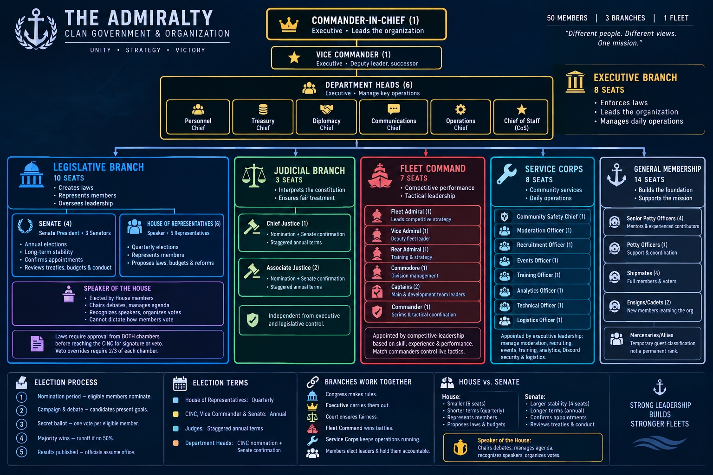

# The Admiralty × YOLO Tournament
## Participant Field Guide and Mock Season Chronicle

<figure>

<figcaption>Source image: <code>dwbotStuff/admiralty_organizational_chart.jpg</code>. The 50 positions belong to the fictional Admiralty setting; they are not a YOLO player limit.</figcaption>
</figure>

**Version:** v0.1 proposal / narrative companion  
**Audience:** Participants, team representatives, captains, hosts, referees, scorekeepers and viewers  
**Status:** PROPOSAL — illustrative mock tournament, not an event notice, signed settings record, prize announcement, or approval of a live event.

> **The one rule to remember:** A match win advances the weekly bracket. Individual damage drives the announced damage awards and cumulative Grand YOLO damage standings. These are related but separate results.

> **Configuration warning:** World of Warships tournament configurations often change. Maps, ship bans, team sizes, tiers, modes, schedules, eligibility, scoring settings and bracket formats must be checked against the current event's official regional notice and signed settings before registration and again before ready-up.

## Welcome to the Quarterdeck

The YOLO Tournament is a World of Warships event built around mixed battles against bots and human opponents, individual performance, weekly team drafts and a season-ending Grand YOLO. The Admiralty gives the story its command structure and visual language. The CBStrat guide supplies the tactical lessons. The YOLO rules, Pilot document, workbook examples and Discord messages provide the tournament's source material.

This is a *mock season*: characters, dialogue, match events and example results below are fictional. The source rules and the proposed extensions are labeled separately so that a compelling story never becomes a hidden rule change.

### How to read this guide

- **SOURCE RULE** — directly supported by the supplied YOLO or Admiralty materials.
- **CURRENT POLICY** — a project policy already recorded in DWBOT documentation, not proof of an approved live event.
- **PROPOSAL** — a suggested rule or operating detail that still requires organizer ratification.
- **MOCK STORY** — fictional people, dialogue, scores and battle events used to explain how the tournament works.

## 1. The Admiralty: who keeps the fleet moving?

The Admiralty handbook describes a fictional clan of fifty positions organized across six groups: Executive, Legislative, Judicial, Fleet Command, Service Corps and General Membership. Its design separates policy, administration, live tactical command, dispute review and community operations. The tournament borrows that separation.

| Admiralty group | Tournament translation | What it does — and does not do |
|---|---|---|
| Executive Branch | Event director, deputy and department heads | Owns the event calendar, approvals, budgets, official notices and operational coordination. It does not secretly change a match after it starts. |
| Legislative Branch | Member representatives / rules forum | Proposes and reviews durable tournament rules, participant protections and resource decisions. It does not call live battles. |
| Judicial Branch | Independent review panel | Hears disputes and appeals, reviews evidence and checks whether process was followed. It does not choose a team's tactics. |
| Fleet Command | Tournament strategy, training and match commanders | Builds tactical doctrine, prepares callers and controls live match tactics within the published rules. |
| Service Corps | Events, safety, moderation, recruitment, training, analytics, technical and logistics staff | Keeps registration, rooms, communications, evidence, schedules and support functioning. |
| General Membership | Participants, mentors, volunteers and developing players | Supplies the competitors and community the event exists to serve. |

The Admiralty's source rules describe a Commander-in-Chief and Vice Commander; six executive department heads; a two-chamber legislature; an independent three-seat judiciary; seven merit-appointed Fleet Command posts; eight Service Corps posts; and fourteen general-membership positions. The fictional headcount is a worldbuilding device, not an instruction to appoint fifty tournament staff.

### The cast of the mock season

The following characters come from the Admiralty handbook's PDF narrative. Their tournament dialogue is dramatized for this guide.

- **Rowan “Anchor” Pierce** — Commander-in-Chief. He wants a fair, repeatable event where a hard decision is explained.
- **Elias “Wake” Mercer** — Rowan's former co-captain and competitive-standard advocate. He insists that expectations be clear before battle, not explained after a loss.
- **Mira “Valkyrie” Solano** — Vice Commander. She connects experienced players, new participants and the training pipeline.
- **Jonah “Tide” Bell** — training-calendar organizer. He turns Mira's mentorship goal into a schedule, caller rotations and a substitute plan.
- **Ava “Chartroom” Keene** — Senate President and keeper of a legible decision ledger.
- **Darius “Keel” Holt** — privacy-minded analyst. He asks that attendance and score records retain context and not become public shaming tools.
- **Lucas “Soundings” Chen** — member representative who turns recurring questions into agenda items.
- **Elena “Sparrow” Cruz** — events advocate who keeps the calendar welcoming and visible.
- **Victor “Spear” Moreno** — Fleet Admiral. He values calm calling, replay review and tactical learning.
- **Rhea “Crosswind” Patel** — a due-process advocate whose fictional appeal tests the record, not the dignity of a losing competitor.
- **Selene Ward** — Chief Justice in the fictional Admiralty, leading an independent review.

The handbook's two `govRec` boards contain alternate character names and election details. They are visual concept boards, not a second canon to be silently merged into the handbook story.

## 2. The tournament in one minute

**SOURCE RULE — recurring YOLO format**

- Each weekly event night has three rounds.
- Each participant is expected to play about seven games.
- Round 1 is against bots. Rounds 2 and 3 are mixed human/bot contests.
- Teams are randomly drafted for the evening; a new draft is made each week.
- Round 1 seeding is first-come-first-served. Later rounds use wins.
- The third-place/consolation bracket is intended to keep teams playing through each round.
- A match win advances a team through the bracket.
- Individual damage determines the announced nightly damage awards and contributes to the cumulative Grand YOLO damage standings and prizes.

**SOURCE RULE — approximate event-night timing**

- Battles are planned for ten minutes.
- The recurring rules describe ten minutes between matches for reporting and fifteen-minute breaks between rounds.
- The whole evening is estimated at two to three hours.
- Exact start times, time zone, registration windows and room allocations are event-specific and must be published.

### Pilot versus recurring season

| Topic | Pilot Event | Recurring weekly YOLO |
|---|---|---|
| Purpose | Rehearse the format and scoring in a simplified one-off event | Build cumulative standings and weekly bracket progression |
| Registration | Source says no prior registration; show up, with entry closing one hour before start | Register individually for each week; new random team draft each week |
| Lineups | Visible | Hidden until the two sides are sorted and ready-up checks are complete |
| Rooms | Training Rooms | Training Rooms |
| Human/bot mix | Six humans and six bots per room; if short, bot count mirrors human count | Round 1 described as 2v6 (a later note allows 3v9); later rounds are 6v6 or 9v9 with two or three humans per side and bots filling the remaining slots |
| Result emphasis | Individual damage for the announced Pilot placement/award | Wins advance the bracket; individual damage determines damage awards and cumulative Grand YOLO standing |
| Final special match | Pilot document describes an Ocean special-mode final match, but its label and duration conflict with other sources | Separate Race side-event appears every third week; its timing/mode conflict is unresolved |

Do not apply Pilot rules to a recurring event or recurring rules to a Pilot unless the event's signed settings explicitly say so.

## 3. The story begins: Pilot Night at the training room

### Scene 1 — The muster

The fictional Admiralty's Events Officer, Rafael “Quarterdeck” Ortiz, posts the Pilot notice. Mira asks the roster team to make room for first-timers. Jonah prepares the voice schedule. Inez Park checks the room and technical fallback. Quinn Baxter confirms the host and backup host. Victor Moreno asks that a referee and scorekeeper be named before the first battle.

Rowan reads the Pilot baseline aloud: no prior registration; join by the one-hour cutoff; final lineups appear thirty minutes before games. Each room is planned for six human players and six bots. If the human roster is short, the bot count mirrors the human count. The event uses Training Rooms, and the lineups are visible.

Elias asks one question: “What happens if the room is wrong?”

The answer is not “guess.” Both sides check the map, mode, duration, side assignments, slots and lineup. If the room does not match the event settings, the host calls the referee before ready-up.

### Scene 2 — Seven games, one lesson

The Pilot document describes approximately seven games per participant, with ten-minute standard battles, reporting intervals and a break. It also lists an Ocean special-mode final match. Other supplied source tables describe that special mode differently: one says five minutes, another ten minutes, and the recurring Race narrative says thirty minutes. The mock Pilot therefore uses only the verified ten-minute Standard Battle baseline until a real event's current-client mode and duration are confirmed.

After the battle, each participant submits the original readable post-game result screenshot through the designated channel. The screenshot must show the player's damage and whether the battle was a win or loss. DWBOT's record acceptance additionally requires all nine mandatory fields:

1. `result`
2. `player`
3. `map`
4. `mode`
5. `battleStart`
6. `credits`
7. `freeXp`
8. `damage`
9. `xp`

Do not edit a screenshot, crop away relevant evidence, infer an unreadable value or substitute an OCR guess. A bot extraction is a candidate until checked against the original evidence and accepted under the event's process. If a field cannot be read, preserve it as unresolved.

### Scene 3 — The first ledger dispute

A Discord summary says damage, not wins, determines ranking and prizes. Elias points to the recurring rules: a team must win its game to advance. Ava opens the source documents side by side.

“Both statements are trying to describe different columns,” she says. “Wins move the bracket. Damage ranks the individual damage awards and cumulative Grand YOLO damage.”

Darius adds that a record must preserve both values. The team result and each player's damage are not interchangeable. The source distinction becomes a standing lesson in every score report.

## 4. A weekly event: three rounds and a changing crew

### Round 1 — Bots and the opening read

The recurring source describes a 2v6 bot contest, with a later note allowing 3v9 depending on turnout. It also describes first-round seeding as first-come-first-served.

The CBStrat lesson is to gain information before committing. A player in a scouting role watches likely approaches, shares enemy positions and avoids being isolated. A supporting player keeps a firing angle available. The team does not rush into the middle merely because the opponent is a bot.

### Rounds 2 and 3 — Human opponents and mixed teams

The recurring source describes 6v6 or 9v9 mixed teams, with two or three humans per side and bots filling the other slots. It also says later-round seeding is based on wins.

The mock story follows two drafted groups. Rowan's team draws a destroyer player who scouts the western approach, a cruiser player who supports the objective, and a battleship player who anchors the firing line. Their bot slots fill the rest of the room. Elias calls the focus target; Mira checks that the support group can actually shoot it.

The tactical plan is simple: spot, call, focus, reposition. The group does not split so far apart that one side can be defeated before the other can help.

### The third-place bracket

The recurring source describes a third-place bracket so teams continue to play in every round. The intent is to keep the evening active and give participants more than a single elimination game. The exact bracket implementation must still be shown in the event's live bracket and approved settings.

## 5. Tactics from CBStrat — adapted to YOLO

<figure>

<figcaption>Exact source image: <code>dwbotStuff/cb strat img ref.png</code>. It describes Tier X Clan Battles; use its general principles, not its specific ship lineup, as the YOLO teaching framework.</figcaption>
</figure>

The CBStrat source is a Tier X Clan Battles guide. Its recommended seven-ship lineup, ship restrictions and assumed radar coverage are not YOLO rules. YOLO's supplied recurring rules are low-tier and mixed with bots. Adapt the *jobs*, not the named Tier X ships.

### The seven tactical habits

1. **Vision before commitment.** Find where the enemy is, share the information and avoid revealing your own approach too early.
2. **Support the objective.** A capture area is not a reason to charge alone. Contest it when your team can support the approach or deny the enemy's capture.
3. **Call before focus.** Name the target and the firing window. A spotted target matters most when allied guns are ready.
4. **Create a crossfire.** Two different firing angles can force an enemy to turn broadside or give up a position. Do not stack every ship in one lane.
5. **Push with a local advantage.** Push when an enemy is isolated, low, split, or unable to support its allies—and when your group has an exit route.
6. **Hold when the score favors patience.** If your team is ahead and controls the objectives, preserve ships, keep vision and make the enemy cross dangerous water.
7. **Adapt roles, not hulls.** If a legal ship lacks radar, hydro, smoke or another tool, do not pretend the consumable exists. Cover the missing job with positioning, scouting or a different support angle.

### A practical role card

| Role | Main job | Common mistake |
|---|---|---|
| Scout / vision | Reveal approaches, report positions, survive to keep information flowing | Firing too early and losing concealment without a trade |
| Objective contest | Pressure a cap, reset enemy capture progress, avoid unsupported entry | Treating capture progress as more important than survival |
| Anchor / fire support | Threaten lanes, punish exposed targets, support a controlled push | Turning slowly into a crossfire or sailing alone |
| Crossfire support | Find a second angle and make enemy angling difficult | Flanking so far away that support arrives too late |
| Caller | Identify target, timing, push/hold choice and retreat cue | Giving vague calls after the firing window has passed |
| Reserve / substitute | Fill a missing job, preserve readiness and follow the roster lock | Entering without knowing the plan or current ship restrictions |

### Push or hold?

**Push** when the enemy is split or isolated, your team can focus one target, the approach is not covered by multiple enemy firing angles, and the assault group has an exit route.

**Hold** when you already control the objectives needed to win, have safe firing positions, can reset enemy capture attempts and can make the opponent move first.

Change the plan when the score, ship count, consumables, map position or available support changes. Do not trade a ship for damage that does not advance the win condition.

### World of Warships terminology in plain language

- **Destroyer (DD):** often used for scouting, concealment, torpedo pressure and capture-point contesting. Its exact job depends on the ship and current rules.
- **Cruiser (CA):** a flexible support class that can respond to threats, screen allies, pressure destroyers and provide sustained fire.
- **Battleship (BB):** a heavy fire-support anchor with strong guns and protection, but slower handling and a need to plan turns and exposure.
- **Spotting / detection:** an enemy is spotted when detection conditions are met; line of sight and detectability matter. Information is useful only if the team can act on it.
- **Concealment:** the distance at which the ship can be detected. Firing the main guns can increase surface detectability.
- **Broadside / angling:** exposing the side of a ship can create a damaging shot; angling can reduce the threat from incoming fire.
- **Crossfire:** two different firing directions that force an opponent to choose which threat to face.
- **Kiting:** moving away while keeping guns on the enemy, often to preserve distance and draw opponents into an unfavorable approach.
- **Cap / reset:** a capture objective; resetting interrupts an opponent's capture progress.
- **Radar / hydro / smoke:** ship-specific consumables. Smoke is not immunity; radar and hydro can reveal targets under their applicable conditions. Only use tools actually available on the legal ship.

## 6. The season at sea

The recurring YOLO source provides a candidate twelve-stage sequence, but its date/time cells are blank. The map rotation is a planning source, not a published calendar.

| Template week | Source map label | Additional note |
|---:|---|---|
| 1 | Islands | Standard Battle baseline |
| 2 | Polar | Standard Battle baseline |
| 3 | Big Race | Map name; separate Race side-event is also described |
| 4 | Archipelago | Standard Battle baseline |
| 5 | Ring | Standard Battle baseline |
| 6 | Straight | Standard Battle baseline |
| 7 | New Dawn | Standard Battle baseline |
| 8 | Islands | Standard Battle baseline |
| 9 | Polar | Standard Battle baseline |
| 10 | Big Race | Map name, not the separate Race side-event |
| 11 | Archipelago | Standard Battle baseline |
| 12 | Ocean | Grand YOLO + Race is listed; exact special mode and duration need approval |

### Race weeks

The recurring source says a separate Race is held every third week, one hour before the main event, for the lower half of the cumulative damage standings. The Race uses an Ocean route and stationary, non-firing bots. The first finisher receives a 10% Race-winnings increase; a participant who dies loses 10%. Race damage contributes to cumulative Grand YOLO damage/seeding, not that evening's regular event total.

The source's Race narrative says thirty minutes, while the Pilot and recurring map tables list different special-match durations. The exact Race event configuration is unresolved and must be stated in the event settings record before it is announced.

### The Admiralty's ten-week arc and the YOLO twelve-stage calendar

The Admiralty handbook's ten-week “first competitive season” is a fictional clan-development plan: pre-season, baseline, mid-cycle, competitive push and review. The YOLO rules provide a separate candidate twelve-stage weekly event sequence. The mock season uses the Admiralty's *phase logic* to organize the story, not to replace the YOLO map table:

- **Preparation / Pilot:** learn the roster, check rooms and test evidence.
- **Baseline:** run the first weekly fixtures and establish consistent calls.
- **Mid-cycle:** review replays, adjust role coverage and prepare Race participants.
- **Competitive push:** focus on bracket progression and season standings.
- **Review / finale:** publish the verified record, resolve disputes and hold the approved Grand YOLO event.

## 7. Playoffs and Grand YOLO

### What the supplied YOLO rules establish

The recurring source describes weekly bracket advancement by wins and a Grand YOLO bracket seeded by cumulative damage. It does not fully specify a separate season-playoff field, qualification threshold, bracket type, series lengths or byes.

### Proposed mock playoff

The current Season Logistics blueprint proposes the following starting point. Every item below remains a **PROPOSAL** until an organizer records approval:

- Top eight eligible entrants by verified regular-season standings.
- Minimum participation of six of twelve regular-season events.
- Seeds 1–8 from the verified standings, with published tie-breaks.
- Single-elimination bracket.
- Quarterfinals and semifinals best-of-three; championship final best-of-five; third-place match best-of-three.
- Pilot results do not qualify or seed the season playoffs.
- A separate Grand YOLO closing event, with its own map, mode, room, award and scoring settings.

This proposal borrows the Admiralty handbook's season-review and playoff storytelling structure and general esports bracket patterns. It does not pretend that the original YOLO source already approved these details.

### Grand YOLO: two names, two different things

1. **Grand YOLO as the season finale:** the final championship event in which the approved bracket determines the champion, while cumulative damage across prior events and the finale determines individual damage prize placement under the published rules.
2. **Grand Yolo as workbook Round 4:** an individual weighted score sheet combining class, tier, damage, kills and time. It is not automatically the finale's team match-outcome formula or the bracket engine.

The event settings must say whether the Round 4 calculator is used, and for what purpose. Do not silently convert a Doubloon formula into a team win/loss rule.

## 8. Scoring: what the numbers mean

### Keep four outputs separate

- **Battle result:** the observed Win/Loss/Draw for a game.
- **Bracket result:** the verified match/series outcome used for advancement.
- **Individual event score:** a player's formula output for a specific event sheet.
- **Award / cumulative damage standing:** the published individual award or season prize calculation.

A screenshot, OCR result, score calculator, bracket win and prize are not interchangeable. The approved event settings and canonical workbook/formula control any live award or advancement decision.

### Historical Damage and Kills formula

The supplied Discord workbook explanation and archival sample workbook use this structure for each player's seven game entries:

`Doubloons = 2 × eventMultiplier × pool × Σ(classWeight × (gameMetric / eventTotalMetric) / tier^tierPower)`

- Damage event: `gameMetric` is damage.
- Kills event: `gameMetric` is kills.
- Sample defaults: pool 500, multiplier 1, tier power 1; sample class weights DD=4, CA=3, BB=2.
- The total is across the event's players and game entries.

**Example from the supplied Discord guide:** pool 500, DD weight 4, tier 2, damage 20,000, event-wide damage 1,000,000:

`2 × 500 × [4 × (20,000 ÷ 1,000,000) ÷ 2] = 40 Doubloons`

If the same contribution applies across seven games, the result is 280 Doubloons. This is a historical illustrative example, not a prize promise.

### Race formula policy

The archival workbook's Race sheet uses raw elapsed seconds as the share metric, which rewards a slower time more than a faster time. The DWBOT scoring policy C01 specifies inverse elapsed seconds:

`RaceShare = (1 / player's elapsed seconds) / Σ(1 / every eligible player's elapsed seconds)`

With the same class and tier, a 60-second time has twice the inverse-time share of a 120-second time. The current DWBOT and standalone HTML calculator have been changed to this policy; exact-head automated verification must pass before claiming release parity.

### Historical Grand Yolo formula

The supplied archival workbook combines each player's total-damage share with seven weighted per-game contributions:

`GrandScore = eventMultiplier / 3 × (playerTotalDamage / allPlayersTotalDamage) × Σ(classWeight × [100×tierWeight/tier + damage×damageWeight/(tier×1000) + 10×kills×killsWeight/tier + 5000×timeWeight/seconds])`

The archival sample uses Grand tier weight 0.9 and other Grand weights of 1. The Grand pool input is not used by the observed formula. The historical class-preference controls labelled for DD/CA/BB are not referenced by the formula.

### Historical Tourney Totals

The archival summary tab:
- sums Doubloons from all four event tabs;
- averages total Damage from Event 1 and Grand Yolo;
- averages Tier over 21 entries from Events 1, 2 and 4;
- averages Kills over seven Event 2 games;
- maps average class weight to DD (>3.6), CA (2.7–3.6) or BB (<2.7);
- shows a historical dollar equivalent of `0.54 × Doubloons / 100`.

The dollar figure is not an official Wargaming exchange rate or an approved prize value. It is not shown as a public DWBOT award estimate by default.

**Scoring authority:** `test27xlsm.xlsm` is an archival sample, not the designated canonical workbook. The formulas above explain the source and support test cases; they do not certify live scoring, event awards or bracket progression. The current canonical workbook and event-specific settings must be approved before live scoring certification.

## 9. Discord: the digital quarterdeck

The Admiralty handbook describes Discord as a command room, community space and record of decisions. The YOLO source uses Discord for event registration, voice coordination, score reporting and help.

A proposed channel map for a future event server is:

| Channel / area | Purpose | Visibility principle |
|---|---|---|
| `#announcements` | Official event notices, rules versions and results | Read access for all participants |
| `#events` | Calendar, attendance polls and event links | Published schedule and event owner |
| `#registration` | Weekly intent to play and availability | Organizer-managed roster records |
| `#competitive` | Team assignments, match coordination and tactical notes | Participants and authorized staff |
| `#training` | Guides, caller practice and replay review | Open learning channel |
| `#score-reporting` | Original post-battle screenshots and result submissions | Restricted to the configured intake route and authorized reviewers |
| `#help-desk` voice | Game-night help and referee contact | Event-time support |
| `#support` | Private safety, technical or conduct reports | Restricted, need-to-know access |

**PROPOSAL / IMPLEMENTATION LIMIT:** this is a recommended channel map, not proof those channels exist. The current DWBOT intake is configured around one designated Discord channel; a multi-channel design or new permissions require a separate implementation and security review. Never post tokens, passwords, private account data or private moderation records in public channels.

### Who does what on event night?

- **Event director:** owns the approved settings, schedule and official notices.
- **Room host:** opens the Training Room, checks the map/mode/timer and invites the opponent.
- **Team representative:** confirms roster, lineup and readiness for the team.
- **Referee:** handles attendance, room faults, restart requests and disputes.
- **Scorekeeper:** links source evidence to participant/game IDs, verifies inputs and preserves corrections.
- **Streamer:** follows the event's broadcast rules and uses the approved delay, overlays and VOD procedure.
- **Participant:** checks the event notice, plays the assigned game, submits the original result and checks the accepted record.

The Admiralty source assigns live tactics to match commanders and keeps dispute review separate. That separation is central: a referee may rule on a room fault; a caller decides whether to push or hold; a scorekeeper records the verified values; an independent reviewer handles an appeal.

## 10. Participant checklist

### Before the event
- Read the current event notice and the exact Pilot or recurring ruleset it names.
- Confirm time zone, start time, arrival cutoff, eligibility, in-game identity, team assignment, map/mode and ship allowlist.
- Join the official Discord communications route and know the referee/help contact.
- Enable replays if required by the event; the recurring source says to retain them for at least 48 hours.
- Check the current ship bans and availability. Do not assume last week's list is still valid.

### Before ready-up
- Confirm game ID, opponent, map, mode, duration, side/spawn, lineup visibility, ship legality and observer permissions.
- Raise room errors before ready-up. The two representatives should verify independently.
- Do not assume a restart, extension or lineup change is permitted.

### After each game
- Save the original result screenshot and replay.
- Submit the readable screenshot using the official route.
- Check damage and Win/Loss, and verify all nine DWBOT fields if the record is submitted to DWBOT.
- Preserve the original if OCR is uncertain; never edit a number to match a calculator.
- Submit corrections through the published route and keep the game ID and original evidence.

### Conduct
The supplied recurring rules expect respectful play, no deliberate throwing/trolling, no unnecessary delay, and prompt communication about technical problems. Disputes should be handled through the referee and documented appeal path, not public accusations.

## 11. Tournament operations and rule changes

The recurring YOLO source includes the following operational baselines:
- Training Rooms are used.
- The Home Team is the top bracket entry and opens the room, names it `Team 1 vs Team 2`, and invites the opponent and approved streamers.
- Teams may change lineups between games, but not during an approved restart.
- Both sides verify room settings. If an error is found after two minutes of game time, the source says the game is played to completion and remains valid.
- The recurring source gives a ten-minute scheduled-start / between-game wait, a five-minute restart completion window, and a two-minute cutoff for ordinary restart requests. Restart quotas differ by series length.
- Official streams have a minimum five-minute delay and additional neutrality, VOD, overlay and conflict-of-interest rules.

These are source baselines, not a replacement for the signed event settings. The organizer may need to reconcile the Pilot and recurring rules before publishing a particular event.

## 12. The final night: a mock Grand YOLO

The fictional season closes with a Grand YOLO event. The bracket is posted only after the qualifying records, corrections and disputes are reconciled. The Fleet Command caller, not the legislature, controls live tactics. Ava publishes the verified results; Darius adds the context needed to interpret the numbers; Rhea's appeal is reviewed independently.

In the final, the team that is ahead does not chase damage into a crossfire. It holds the objective, preserves vision and forces the opponent to move. The team that is behind does not scatter across the map; it selects one achievable target, calls the focus and creates a short local advantage.

After the last battle, the event director publishes the verified champion and placements. The scorekeeper publishes individual damage awards only after the approved formula and inputs are checked. The final ledger distinguishes bracket advancement, individual scoring and actual prize distribution.

Rowan's closing note is brief: “A result is worth publishing when everyone can see what it means.” Elias adds: “And the standard must be known before the next battle.” Mira asks Jonah to publish the next training calendar. Ava closes the ledger. Victor schedules the replay review.

The Admiralty's promise becomes the tournament's lesson: a strong fleet is not only a fleet that wins. It is a fleet that can explain its rules, learn from a loss and return for the next event.

## 13. Source and further reading

### Supplied project sources
- [Admiralty handbook PDF](../dwbotStuff/admiralty_first_election_handbook.pdf)
- [Admiralty organization chart](../dwbotStuff/admiralty_organizational_chart.jpg)
- [Admiralty visual concept board 1](../dwbotStuff/govRec1.png) — visual study only
- [Admiralty visual concept board 2](../dwbotStuff/govRec2.png) — visual study only
- [CBStrat Tier X Clan Battles guide](../dwbotStuff/Tier_X_Clan_Battles_Competitive_Strategy_Final_Page_Image.pdf)
- [CBStrat strategy infographic](../dwbotStuff/cb%20strat%20img%20ref.png)
- [YOLO recurring rules source](../dwbotStuff/yolo_rules_xmpl.docx)
- [YOLO Pilot source](../dwbotStuff/yolo_event.docx)
- [YOLO introductory design PDF](../dwbotStuff/yolo_description.pdf)
- [Historical score example image](../dwbotStuff/mtheqfnl.jpg)
- [Preserved Discord scoring explanation](../dwbotStuff/discordMsgs/how%20yolo%20wkbk%20work%20discord.txt)
- [Preserved Discord scoring guide](../dwbotStuff/discordMsgs/yolo%20scoring%20guide%20discord.txt)
- [Preserved Discord YOLO summary](../dwbotStuff/discordMsgs/yolo%20summary%20discord.txt)
- [Season logistics and Grand YOLO proposal](Season_Logistics_and_Grand_YOLO_Finale_Blueprint_v0.2_PROPOSAL.md)
- [Source reconciliation and visual provenance](Admiralty_YOLO_Source_Reconciliation_and_Visual_Provenance_v0.1.md)

### Current game and tournament references
- [Wargaming — World of Warships](https://wargaming.net/en/games/wows)
- [World of Warships Wiki — overview and ship classes](https://wiki.worldofwarships.com/World_of_Warships)
- [Wiki — Battleships](https://wiki.worldofwarships.com/Ship:Battleships)
- [Wiki — Cruisers](https://wiki.worldofwarships.com/Ship:Cruisers)
- [Wiki — Detection and concealment](https://wiki.worldofwarships.com/Ship:Detection)
- [WoWs Tournaments](https://wows-tournaments.com/)
- [WoWS Numbers NA](https://na.wows-numbers.com/) — optional public statistics and replay context; not an eligibility or official tournament authority
- [DevStrike — Destroyer Fundamentals](https://www.devstrike.net/topic/9388-destroyer-fundamentals-the-definitive-guide/) — community guide, not official rules
- [DevStrike — Operations Guide](https://www.devstrike.net/topic/10196-operations-game-mode-guide-world-of-warships/) — community guide, not official rules
- [Turnio — esports tournament formats](https://turnio.net/esports-tournament-guide/)
- [ScoreLeader — how brackets work](https://scoreleader.com/how-tournament-brackets-work/)

---

**Publication boundary:** This is a narrative teaching companion and mock event. It does not authorize a live event, create a prize pool, select a real participant, set a calendar, approve a ship list, or supersede the event-specific settings record. Configurations frequently change; use the current official event rules every time.

### Current public tournament example (checked 2026-11-06)

The WoWs Tournaments listing shows **King of the Sea XIX** scheduled 9 October–15 November 2026, with separate Europe, North America, APAC and International sections. Wargaming's official event page lists the International Finals over the weekends of 7–8 and 14–15 November, and the associated in-game event rewards page remains active through 2 December. These are KOTS dates, not YOLO dates. The example illustrates why event settings need a region, phase, signup window, match schedule and versioned notice rather than one ambiguous calendar entry. See [WoWs Tournaments](https://wows-tournaments.com/) and [Wargaming's King of the Sea XIX page](https://worldofwarships.com/en/content/king-of-the-sea-xix-tournament/).

